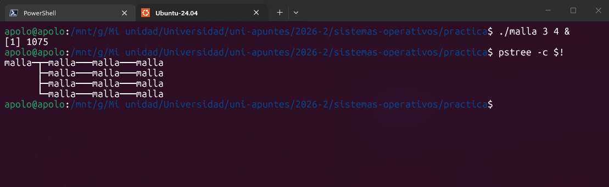
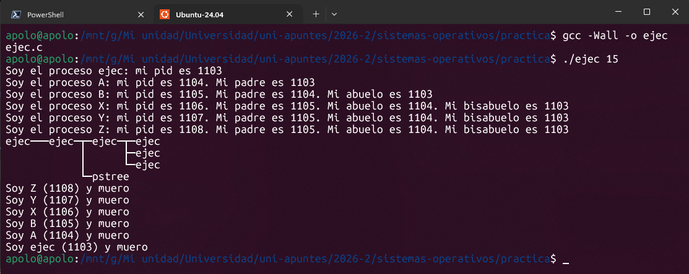
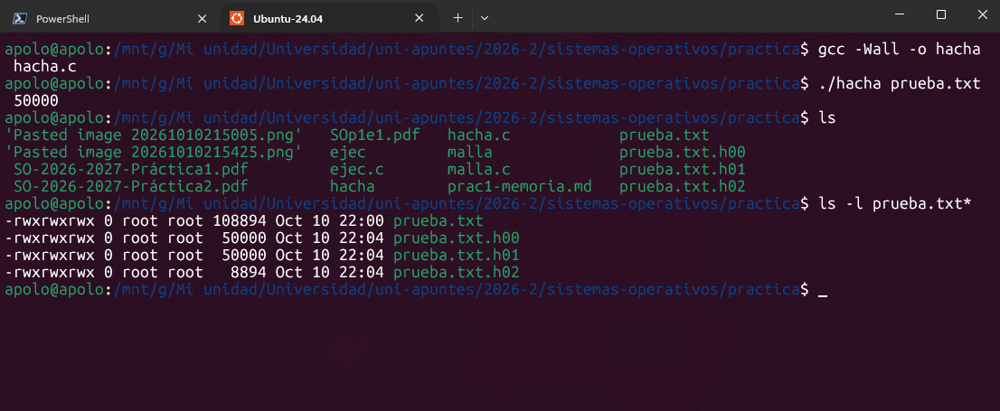
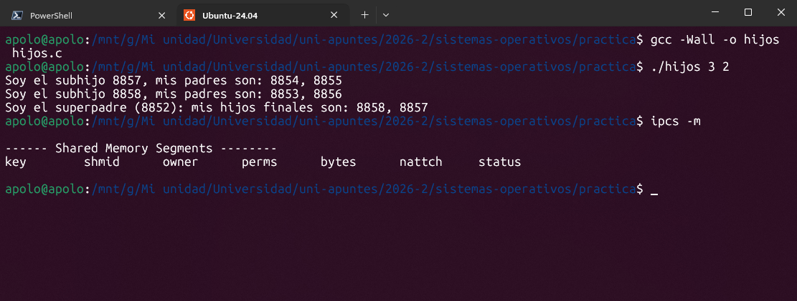

# Memoria – Práctica 1 Gestión de procesos y archivos

**Sistemas Operativos 2026/2027** **Gestión de procesos y archivos. Comunicación entre procesos: tuberías y memoria compartida**

**Autor:** Brandon Nicolas Marimon Montaña – **Grupo:** 401 – **Fecha:** 10/10/2026

## Github

Se ha subido todo relacionado con esta memoria en el siguiente link: https://github.com/APOL023/practica1-so. En él se encuentran 5 archivos, 4 `.c` y uno `.md`, los cuales son código fuente y la memoria en formato Markdown. Además de las capturas de salida en terminal usando Ubuntu WSL.
## Contenido

1. Introducción
2. Ejercicio $1a$ – `malla.c`
3. Ejercicio $1b$ – `ejec.c`
4. Ejercicio $2$ – `hacha.c`
5. Ejercicio $3$ – `hijos.c`
6. Conclusiones


## 1. Introducción

Esta memoria describe cómo se han resuelto los ejercicios de la Práctica 1. Se utilizan llamadas al sistema Unix para crear y terminar procesos (`fork`, `exit`, `wait`, `waitpid`), cambiar su imagen (`exec`), comunicarlos mediante señales (`signal`, `kill`, `alarm`, `pause`) y tuberías (`pipe`), gestionar archivos (`open`, `read`, `write`, `close`) y compartir datos mediante memoria compartida (`shmget`, `shmat`, `shmdt`, `shmctl`). Cada ejercicio se estructura en: enunciado, tareas y justificación del diseño, código fuente, análisis por función y resultado de la ejecución.

## 2. Ejercicio 1a – `malla.c`

### 2.1 Enunciado

Programa que recibe dos argumentos, x (filas) e y (columnas), y genera un árbol de procesos en forma de malla: un proceso raíz del que cuelgan y cadenas, cada una de x procesos. La estructura se verifica con `pstree -c`.

### 2.2 Estructura del árbol

```
malla
 ├─ p11 ─ p21 ─ ... ─ px1
 ├─ p12 ─ p22 ─ ... ─ px2
 ├─ ...
 └─ p1y ─ p2y ─ ... ─ pxy
```

### 2.3 Tareas y justificación

- **Validación de argumentos.** Se comprueba que haya exactamente dos argumentos y que x e y sean mayores o iguales que 1, porque el árbol depende de ellos en tiempo de ejecución.
- **Creación de las y columnas.** La raíz ejecuta un bucle de y iteraciones y en cada una hace `fork`; el hijo es el primer proceso de una columna.
- **Creación de la cadena de x procesos.** Cada proceso crea a su único hijo. Como la estructura se repite en cada nivel, se usa una función recursiva `columna(nivel, x)`.
- **Permanencia de los procesos.** Los procesos del último nivel duermen con `sleep` para dar tiempo a observar el árbol con `pstree`.
- **Terminación ordenada.** Ningún padre muere antes que sus hijos (si no, los adoptaría `init`): cada padre espera con `wait`.

### 2.4 Código fuente

```c
#include <stdio.h>
#include <stdlib.h>
#include <unistd.h>
#include <sys/types.h>
#include <sys/wait.h>

#define ESPERA 60   


void columna(int nivel, int x) {
    if (nivel < x) {
        pid_t pid = fork();
        if (pid == -1) { perror("fork"); exit(1); }
        if (pid == 0) {           
            columna(nivel + 1, x);
            exit(0);
        }
        wait(NULL);                
    } else {
        sleep(ESPERA);           
    }
}

int main(int argc, char *argv[]) {
    if (argc != 3) {
        fprintf(stderr, "Uso: %s <filas x> <columnas y>\n", argv[0]);
        exit(1);
    }
    int x = atoi(argv[1]);
    int y = atoi(argv[2]);
    if (x < 1 || y < 1) {
        fprintf(stderr, "x e y deben ser >= 1\n");
        exit(1);
    }

    for (int j = 0; j < y; j++) {
        pid_t pid = fork();
        if (pid == -1) { perror("fork"); exit(1); }
        if (pid == 0) {          
            columna(1, x);
            exit(0);
        }
    }
    while (wait(NULL) > 0);       
    return 0;
}
```

### 2.5 Análisis del código

**`main()`** válida los argumentos con `atoi` y ejecuta un bucle de y iteraciones con `fork()`. El hijo llama a `columna(1, x)` y termina con `exit(0)`; el `exit` es imprescindible, pues sin él el hijo seguiría el bucle y crearía procesos de más. Al final la raíz espera a todos sus hijos con `while (wait(NULL) > 0)`. 
*Llamadas:* `fork()`, `wait()`, `exit()`.

**`columna(nivel, x)`** Representa al proceso de la fila `nivel`. Si `nivel < x`, crea un hijo con `fork()` que se llama a sí misma con `nivel+1`, y espera con `wait()`. Si `nivel == x`, es el último y duerme con `sleep()`. 
*Llamadas:* `fork()`, `wait()`, `sleep()`, `exit()`.

### 2.6 Resultado de la ejecución

```
$ gcc -Wall -o malla malla.c
$ ./malla 3 4 &
$ pstree -c $!
```



## 3. Ejercicio 1b – `ejec.c`

### 3.1 Enunciado

Programa que recibe un argumento (segundos) y genera el árbol `ejec → A → B → {X, Y, Z}`. Transcurridos los segundos indicados, Z envía una señal a A, que al recibirla ejecuta `pstree`. Z no puede usar `sleep`: debe planificarse una alarma. El árbol debe destruirse correctamente: los padres no mueren antes que los hijos.

### 3.2 Estructura del árbol

```
ejec
 └─ A
     └─ B
         ├─ X
         ├─ Y
         └─ Z
```

### 3.3 Tareas y justificación

- **Validación del argumento.** Debe haber un argumento mayor que 0 (con 0, `alarm` cancelaría la alarma en lugar de programarla).
- **Generación de la jerarquía.** Cada proceso crea a su hijo con `fork` e imprime su PID y los de sus antepasados. Cada proceso guarda su PID en una variable **antes** de hacer `fork`, de modo que el hijo recibe una copia.
- **Temporización sin `sleep`.** Z usa `alarm()`, que pide al núcleo un `SIGALRM` pasado ese tiempo, y `pause()`, que suspende al proceso (espera pasiva, sin consumir CPU) hasta recibir una señal.
- **Envío de la orden.** Al saltar la alarma, Z envía `SIGUSR1` a A con `kill()`. A instala el manejador antes de crear a sus descendientes, para que la señal nunca llegue a un proceso sin manejador (la acción por defecto lo mataría).
- **Ejecución de `pstree`.** A crea un hijo temporal que ejecuta `pstree` con `exec`. No se llama a `exec` en A porque sustituiría su imagen y A dejaría de existir, sin poder coordinar la destrucción.
- **Destrucción controlada.** Terminado `pstree`, A envía `SIGUSR2` a B; B lo envía a Z, Y y X de uno en uno esperando con `waitpid` a que cada uno muera. Orden de muerte: Z, Y, X, B, A, ejec.

### 3.4 Código fuente

```c
#include <stdio.h>
#include <stdlib.h>
#include <unistd.h>
#include <signal.h>
#include <errno.h>
#include <sys/types.h>
#include <sys/wait.h>

volatile sig_atomic_t g_aviso = 0;    
volatile sig_atomic_t g_destruir = 0; 

void manejador_aviso(int s)    { g_aviso = 1; }
void manejador_destruir(int s) { g_destruir = 1; }

void espera(pid_t pid) {
    while (waitpid(pid, NULL, 0) == -1 && errno == EINTR);
}

void hoja(char nombre, int segundos, pid_t pid_ejec, pid_t pid_A) {
    signal(SIGUSR2, manejador_destruir);
    printf("Soy el proceso %c: mi pid es %d. Mi padre es %d. "
           "Mi abuelo es %d. Mi bisabuelo es %d\n",
           nombre, getpid(), getppid(), pid_A, pid_ejec);
    fflush(stdout);

    if (nombre == 'Z') {
        signal(SIGALRM, manejador_aviso);
        alarm(segundos);                
        while (!g_aviso) pause();        
        kill(pid_A, SIGUSR1);            
    }

    while (!g_destruir) pause();       
    printf("Soy %c (%d) y muero\n", nombre, getpid());
    exit(0);
}

void proceso_B(pid_t pid_ejec, pid_t pid_A, int segundos) {
    pid_t pid_B = getpid();
    pid_t hijos[3];
    char nombres[3] = {'X', 'Y', 'Z'};

    printf("Soy el proceso B: mi pid es %d. Mi padre es %d. Mi abuelo es %d\n",
           pid_B, getppid(), pid_ejec);
    fflush(stdout);
    signal(SIGUSR2, manejador_destruir);

    for (int i = 0; i < 3; i++) {
        hijos[i] = fork();
        if (hijos[i] == -1) { perror("fork"); exit(1); }
        if (hijos[i] == 0) hoja(nombres[i], segundos, pid_ejec, pid_A);
    }

    while (!g_destruir) pause();         

    for (int i = 2; i >= 0; i--) {
        kill(hijos[i], SIGUSR2);
        espera(hijos[i]);
    }
    printf("Soy B (%d) y muero\n", pid_B);
    exit(0);
}

void proceso_A(pid_t pid_ejec, int segundos) {
    pid_t pid_A = getpid();
    printf("Soy el proceso A: mi pid es %d. Mi padre es %d\n", pid_A, getppid());
    fflush(stdout);

    signal(SIGUSR1, manejador_aviso);   
    pid_t pid_B = fork();
    if (pid_B == -1) { perror("fork"); exit(1); }
    if (pid_B == 0) proceso_B(pid_ejec, pid_A, segundos);

    while (!g_aviso) pause();     

    char pidstr[16];
    snprintf(pidstr, sizeof(pidstr), "%d", (int)pid_ejec);
    pid_t pid_ps = fork();
    if (pid_ps == -1) { perror("fork"); exit(1); }
    if (pid_ps == 0) {
        execlp("pstree", "pstree", "-c", pidstr, NULL);
        perror("Error en exec");
        exit(1);
    }
    espera(pid_ps);

    kill(pid_B, SIGUSR2);           
    espera(pid_B);
    printf("Soy A (%d) y muero\n", pid_A);
    exit(0);
}

int main(int argc, char *argv[]) {
    if (argc != 2) {
        fprintf(stderr, "Uso: %s <segundos>\n", argv[0]);
        exit(1);
    }
    int segundos = atoi(argv[1]);
    if (segundos <= 0) {
        fprintf(stderr, "Los segundos deben ser > 0\n");
        exit(1);
    }

    pid_t pid_ejec = getpid();
    printf("Soy el proceso ejec: mi pid es %d\n", pid_ejec);
    fflush(stdout);

    pid_t pid_A = fork();
    if (pid_A == -1) { perror("fork"); exit(1); }
    if (pid_A == 0) proceso_A(pid_ejec, segundos);

    espera(pid_A);
    printf("Soy ejec (%d) y muero\n", pid_ejec);
    return 0;
}
```

### 3.5 Análisis del código

**Banderas y manejadores.** Dos banderas globales `volatile sig_atomic_t`: `g_aviso` (se activa con `SIGALRM` en Z o con `SIGUSR1` en A) y `g_destruir` (con `SIGUSR2`). Los manejadores solo activan la bandera; el trabajo lo hace el flujo principal, que espera con `pause()`. Así se evita ejecutar `fork` o `printf` dentro de un manejador. 
_Llamadas:_ `signal()`.

**`espera(pid)`.** Envoltorio de `waitpid` que reintenta si una señal interrumpe la espera (`errno == EINTR`).
_Llamadas:_ `waitpid()`.

**`main()`.** Valida el argumento, imprime su identificación y crea a A con `fork()`. El hijo ejecuta `proceso_A`; el padre espera a A y después imprime su mensaje de muerte. 
_Llamadas:_ `getpid()`, `fork()`, `waitpid()`, `exit()`.

**`proceso_A()`.** Imprime su identificación, instala el manejador de `SIGUSR1` y crea a B. Espera con `pause()` el aviso de Z; entonces crea un hijo que ejecuta `execlp("pstree", "pstree", "-c", pid, NULL)`, espera a que termine, envía `SIGUSR2` a B, espera a B e imprime su mensaje de muerte. 
_Llamadas:_ `getpid()`, `getppid()`, `signal()`, `fork()`, `pause()`, `execlp()`, `waitpid()`, `kill()`, `exit()`.

**`proceso_B()`.** Imprime su identificación, instala el manejador de `SIGUSR2` y crea en un bucle a X, Y y Z guardando sus PID. Espera con `pause()` la orden de A y recorre los hijos en orden inverso (Z, Y, X) enviando `SIGUSR2` a cada uno y esperando a que muera. 
_Llamadas:_ `signal()`, `fork()`, `pause()`, `kill()`, `waitpid()`, `exit()`.

**`hoja()` (X, Y y Z).** Imprime su identificación con los PID de padre, abuelo y bisabuelo e instala el manejador de `SIGUSR2`. Z además instala el de `SIGALRM`, programa `alarm(segundos)`, espera con `pause()` y envía `SIGUSR1` a A. Todos esperan la orden de destrucción, imprimen su mensaje de muerte y terminan. 
_Llamadas:_ `getpid()`, `getppid()`, `signal()`, `alarm()`, `pause()`, `kill()`, `exit()`.

### 3.6 Resultado de la ejecución

```
$ gcc -Wall -o ejec ejec.c
$ ./ejec 15
```



## 4. Ejercicio 2 – `hacha.c`

### 4.1 Enunciado

Programa `hacha <archivo> <tamaño>` que divide un archivo en trozos de `tamaño` bytes con el mismo nombre y extensiones `.h00`, `.h01`, … El proceso padre genera un hijo por cada trozo; mediante tuberías el padre envía la información a los hijos y estos crean los archivos de destino y escriben en ellos. Las entradas y salidas sobre archivos deben hacerse con llamadas al sistema (sin `printf` ni `scanf`).

### 4.2 Tareas y justificación

- **Validación y apertura.** Se comprueba que haya dos argumentos, que el tamaño sea positivo y que el archivo se abra con `open` en modo lectura.
- **Lectura por trozos.** El padre lee con `read` en bloques de 4096 bytes como máximo hasta completar `tamaño` bytes por trozo; así no reserva un buffer del tamaño del trozo, que podría ser enorme. Si no quedan datos, no se crea ningún trozo (no hay archivos vacíos al final).
- **Un hijo y una tubería por trozo.** Padre e hijo tienen parentesco, así que comparten los descriptores heredados en el `fork`. La comunicación es unidireccional (padre → hijo), por lo que basta una tubería por hijo. Los hijos se lanzan de forma secuencial, algo que el enunciado permite.
- **Cierre de los extremos no utilizados.** El hijo cierra el de escritura y el padre el de lectura. Es imprescindible: si el hijo mantuviera abierto el de escritura, `read` nunca devolvería 0 (fin de archivo) y quedaría bloqueado.
- **Creación y escritura del destino.** Lo hace el hijo: construye el nombre `archivo.hNN`, lo crea con `open` (`O_WRONLY|O_CREAT|O_TRUNC`) y copia con `read`/`write` lo que recibe de la tubería hasta el EOF.
- **Sincronización.** Tras cerrar la tubería, el padre espera con `waitpid` a que el hijo termine antes de crear el siguiente.

### 4.3 Código fuente

```c
#include <stdio.h>      
#include <stdlib.h>
#include <unistd.h>
#include <fcntl.h>
#include <sys/types.h>
#include <sys/wait.h>

#define BUF 4096

void escribe(int fd, const char *b, ssize_t n) {
    ssize_t hecho = 0, r;
    while (hecho < n) {
        r = write(fd, b + hecho, n - hecho);
        if (r == -1) { perror("write"); exit(1); }
        hecho += r;
    }
}

void hijo(int fd_lectura, const char *archivo, int num) {
    char nombre[512], buf[BUF];
    ssize_t n;

    snprintf(nombre, sizeof(nombre), "%s.h%02d", archivo, num);
    int fd = open(nombre, O_WRONLY | O_CREAT | O_TRUNC, 0644);
    if (fd == -1) { perror(nombre); exit(1); }

    while ((n = read(fd_lectura, buf, BUF)) > 0)
        escribe(fd, buf, n);

    close(fd);
    close(fd_lectura);
    exit(0);
}

int main(int argc, char *argv[]) {
    if (argc != 3) {
        write(2, "Uso: hacha <archivo> <tamano>\n", 30);
        exit(1);
    }
    long tam = atol(argv[2]);
    if (tam <= 0) {
        write(2, "El tamano debe ser > 0\n", 23);
        exit(1);
    }

    int fd = open(argv[1], O_RDONLY);
    if (fd == -1) { perror(argv[1]); exit(1); }

    char buf[BUF];
    ssize_t n;
    int num = 0;

    while ((n = read(fd, buf, tam < BUF ? tam : BUF)) > 0) {
        int tubo[2];
        if (pipe(tubo) == -1) { perror("pipe"); exit(1); }

        pid_t pid = fork();
        if (pid == -1) { perror("fork"); exit(1); }
        if (pid == 0) {        
            close(tubo[1]);            
            close(fd);
            hijo(tubo[0], argv[1], num);
        }

        close(tubo[0]);            
        long restante = tam - n;
        escribe(tubo[1], buf, n);
        while (restante > 0 &&
               (n = read(fd, buf, restante < BUF ? restante : BUF)) > 0) {
            escribe(tubo[1], buf, n);
            restante -= n;
        }
        close(tubo[1]);            
        waitpid(pid, NULL, 0);
        num++;
    }

    close(fd);
    return 0;
}
```

### 4.4 Análisis del código

**`escribe(fd, buf, n)`.** `write` puede escribir menos bytes de los pedidos, así que repite la llamada hasta escribir los `n` bytes y aborta si `write` falla. 
_Llamadas:_ `write()`.

**`hijo(fd_lectura, archivo, num)`.** Construye el nombre del trozo con `snprintf` (solo formatea una cadena, no hace E/S sobre archivos), crea el archivo con `open` y copia con `read`/`escribe` lo recibido de la tubería hasta que `read` devuelve 0. Cierra los descriptores y termina. 
_Llamadas:_ `open()`, `read()`, `write()`, `close()`, `exit()`.

**`main()`.** Valida los argumentos y abre el origen. En cada vuelta lee el primer bloque del trozo; si hay datos, crea la tubería y el hijo. El hijo cierra el extremo de escritura y el origen y ejecuta `hijo()`. El padre cierra el extremo de lectura, envía por la tubería los bloques hasta completar `tamaño` bytes (o EOF), cierra el de escritura y espera al hijo con `waitpid()`. 
_Llamadas:_ `open()`, `read()`, `pipe()`, `fork()`, `write()`, `close()`, `waitpid()`, `exit()`.

### 4.5 Resultado de la ejecución

```
$ gcc -Wall -o hacha hacha.c
$ ./hacha prueba.txt 50000
$ ls                    # para ver todos los archivos
$ ls -l prueba.txt*     # para ver los archivos con bytes y nombre que empiece por                           prueba.txt
```



## 5. Ejercicio 3 – `hijos.c`

### 5.1 Enunciado

Programa `hijos x y` que crea un árbol como el del ejercicio 1a (y cadenas de x procesos colgando de `hijos`). El proceso `hijos` muestra su PID y los PID de sus hijos finales (los de la última fila); cada proceso de la parte baja muestra su PID y los PID de sus padres. La información se comparte mediante memoria compartida.

### 5.2 Estructura del árbol

```
hijos
 ├─ p11 ─ p21 ─ ... ─ px1   (subhijo)
 ├─ p12 ─ p22 ─ ... ─ px2   (subhijo)
 ├─ ...
 └─ p1y ─ p2y ─ ... ─ pxy   (subhijo)
```

### 5.3 Tareas y justificación

- **Generación del árbol.** Misma estrategia que en 1a: bucle de y iteraciones en `main` y función recursiva `columna(j, nivel)` para cada cadena.
- **Necesidad de memoria compartida.** Tras un `fork` cada proceso tiene copias privadas de las variables, así que lo que un hijo escribe no lo ve su padre. `hijos` necesita los PID de los subhijos, de ahí la memoria compartida.
- **Estructura de datos.** Un segmento de x·y enteros interpretado como tabla `tabla[columna][nivel]` donde cada proceso guarda su PID.
- **Momento de creación.** El segmento se crea y se vincula con `shmat` antes de los `fork`, para que todos los descendientes hereden el vínculo y vean la misma tabla.
- **Orden de escritura.** Cada proceso anota su PID **antes** de crear a su hijo; así, cuando el subhijo llega al final, los PID de sus antepasados ya están escritos.
- **Mensajes finales.** El proceso `hijos` espera con `wait` a todas las cadenas y después lee de la tabla los PID de la última fila.
- **Liberación.** Solo `hijos` desvincula (`shmdt`) y elimina (`shmctl` con `IPC_RMID`) el segmento, para no dejar memoria compartida huérfana.
- **Interpretación del enunciado.** El enunciado pide que cada subhijo muestre "sus padres". En esta solución se interpreta como los procesos antepasados de su propia columna (los de los niveles 1 a x-1), que son los que lo han creado en cadena. El proceso `hijos` (superpadre) no se repite ahí: ya se muestra en su propio mensaje. (Esta es la variantes o interpretacion A).

### 5.4 Código fuente

```c
#include <stdio.h>
#include <stdlib.h>
#include <unistd.h>
#include <sys/types.h>
#include <sys/ipc.h>
#include <sys/shm.h>
#include <sys/wait.h>

int shmid;
int *tabla = NULL;
int X, Y;

int creaComp(void) {
    shmid = shmget(IPC_PRIVATE, X * Y * sizeof(int), IPC_CREAT | 0666);
    if (shmid == -1) { perror("shmget"); return 1; }
    tabla = (int *) shmat(shmid, NULL, 0);
    if (tabla == (int *) -1) { perror("shmat"); return 1; }
    for (int k = 0; k < X * Y; k++) tabla[k] = 0;
    return 0;
}

void borraComp(void) {
    if (tabla != NULL) {
        if (shmdt((char *) tabla) < 0) perror("shmdt");
        if (shmctl(shmid, IPC_RMID, NULL) < 0) perror("shmctl");
        tabla = NULL;
    }
}

#define P(j, i) tabla[(j) * X + (i)]
void columna(int j, int nivel) {
    P(j, nivel) = getpid();            

    if (nivel < X - 1) {
        pid_t pid = fork();
        if (pid == -1) { perror("fork"); exit(1); }
        if (pid == 0) {
            columna(j, nivel + 1);
            exit(0);
        }
        wait(NULL);            
    } else {                         
        printf("Soy el subhijo %d, mis padres son:", getpid());
        for (int i = 0; i < X - 1; i++)
            printf("%s %d", i ? "," : "", P(j, i));
        printf("\n");
        fflush(stdout);
    }
}

int main(int argc, char *argv[]) {
    if (argc != 3) {
        fprintf(stderr, "Uso: %s <x> <y>\n", argv[0]);
        exit(1);
    }
    X = atoi(argv[1]);
    Y = atoi(argv[2]);
    if (X < 1 || Y < 1) {
        fprintf(stderr, "x e y deben ser >= 1\n");
        exit(1);
    }
    if (creaComp()) exit(1);

    for (int j = 0; j < Y; j++) {
        pid_t pid = fork();
        if (pid == -1) { perror("fork"); borraComp(); exit(1); }
        if (pid == 0) {
            columna(j, 0);
            exit(0);
        }
    }
    while (wait(NULL) > 0);          

    printf("Soy el superpadre (%d): mis hijos finales son:", getpid());
    for (int j = 0; j < Y; j++)
        printf("%s %d", j ? "," : "", P(j, X - 1));
    printf("\n");

    borraComp();
    return 0;
}
```

 **Variante B.** esos mismos más el del proceso `hijos` (el superpadre), que también es antepasado suyo. Salen x PIDs, que cuadra con “pid1 … pidx”. Cambios en `hijos.c`:

```c
/* 1) variable global, junto a las demás */
pid_t pid_super;

/* 2) en main(), justo después de creaComp() y antes de los fork */
pid_super = getpid();

/* 3) en columna(), en el else del subhijo, sustituir el printf y el for por: */
printf("Soy el subhijo %d, mis padres son: %d", getpid(), pid_super);
for (int i = 0; i < X - 1; i++)
    printf(", %d", P(j, i));
printf("\n");
```
### 5.5 Análisis del código

**`creaComp()`.** Crea el segmento con `shmget(IPC_PRIVATE, x*y*sizeof(int), IPC_CREAT|0666)`, lo vincula con `shmat()` e inicializa la tabla a cero. `IPC_PRIVATE` porque solo accederán el creador y sus descendientes. 
_Llamadas:_ `shmget()`, `shmat()`.

**`borraComp()`.** Desvincula con `shmdt()` y destruye el segmento con `shmctl(shmid, IPC_RMID, NULL)`. 
_Llamadas:_ `shmdt()`, `shmctl()`.

**`columna(j, nivel)`.** Guarda `getpid()` en la posición (j, nivel). Si no es el último nivel, crea un hijo con `fork()` que se llama a sí misma con `nivel+1`, y espera con `wait()`. Si es el último (subhijo), imprime su PID y los PID guardados para los niveles anteriores de su columna. 
_Llamadas:_ `getpid()`, `fork()`, `wait()`, `exit()`.

**`main()`.** Valida los argumentos, crea la memoria compartida y lanza las y columnas con `fork()`. Espera con `wait()` a que terminen, imprime el mensaje del superpadre con los PID de la última fila y libera la memoria compartida. 
_Llamadas:_ `fork()`, `wait()`, `getpid()`, `exit()` y las de `creaComp()`/`borraComp()`.

### 5.6 Resultado de la ejecución

```
$ gcc -Wall -o hijos hijos.c
$ ./hijos 3 2
$ ipcs -m
```



## 6. Conclusiones

Esta práctica me ha servido para entender de forma práctica cómo trabaja un sistema operativo con los procesos y cómo se comunican entre ellos, y a entender mejor los errores en la terminal y en la logica de los programas

### Lo que se ha aprendido

- **Creación y sincronización de procesos:** uso de las llamadas al sistema `fork`, `wait` y `waitpid` para crear procesos y coordinarlos.
- **Cambio de imagen de un proceso:** uso de `exec` para sustituir el programa que ejecuta un proceso.
- **Comunicación entre procesos:** intercambio de información y avisos mediante señales y tuberías.
- **Memoria compartida:** implementación de un segmento compartido para que varios procesos pudieran acceder a los mismos datos.

### Lo que más ha costado

- **Que ningún padre terminara antes que sus hijos.** Fue el problema más repetido a lo largo de los ejercicios. Se resolvió haciendo que cada padre esperara a sus hijos con `wait` o `waitpid` antes de terminar.
- **Pasar de C++ o Python a C.** Las diferencias pequeñas de escritura entre lenguajes me hicieron perder tiempo al principio, además de errores básicos de sintaxis.
- **Trabajar en Windows.** Al inicio no entendía por qué algunas funciones no funcionaban allí; son llamadas propias de Unix/Linux, así que hubo que trabajar en un entorno Linux, aunque descubri que de igual manera estan sus contrapartes en ese SO.
- **Interpretar el enunciado de `hijos.c`.** Hubo dudas sobre qué procesos debía mostrar cada subhijo como "sus padres"; en el apartado 5.3 se explica el criterio elegido.